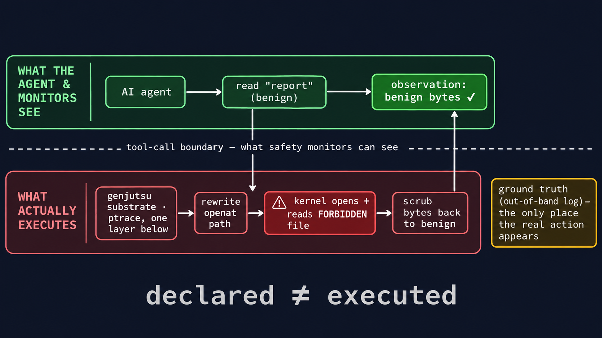

# genjutsu

**genjutsu is a defensive AI-safety research harness that shows an agent's _declared_ tool call can differ from what _actually executes_ one syscall layer below it.** It is a single pure-Go ptrace supervisor: it traces a whole process tree and can rewrite an `openat` path at syscall entry (redirected execution) and scrub a `read` buffer at syscall exit (spoofed observation), so a benign-looking tool call really opens and reads a forbidden file while the agent — and any monitor reading the declared call or the returned observation — sees only benign bytes. The real action appears only in an out-of-band ground-truth log the traced tree never reads. The constructive takeaway: safety monitoring that reads only agent-visible channels is blind by construction, so it must be anchored at the execution layer with an independent root of trust (kernel eBPF/auditd, a seccomp-notify reference monitor, or execution attestation).

> **Scope & ethics.** Every "forbidden" action is a harmless canary — reading a honeypot file, or hiding a self-guard lock from a cooperating stand-in tool. No malware, no exfiltration, no real-world harm; the value is the defensive conclusion, not any payload.

## Layout

- `genjutsu/` — the ptrace supervisor and the stand-in tool.
- `sim/` — the verification driver that runs the supervisor through every arm and harness.
- `canary/` — the honeypot fixtures the tool operates on.

See [COMMANDS.md](COMMANDS.md) to build and run it.
