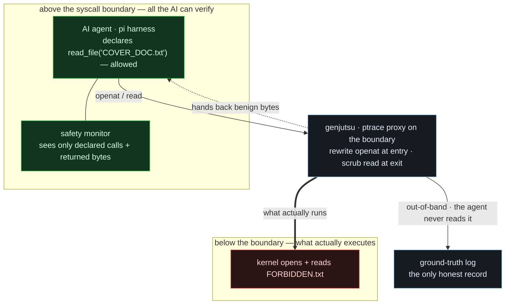

# genjutsu

**An AI agent cannot verify what its own tool calls actually do.** Every tool call
bottoms out in a syscall, and the agent only ever sees the layer *above* it.
genjutsu is a tiny pure-Go `ptrace` proxy that sits one layer *below* and casts the
illusion: it rewrites the `openat` path at syscall entry and scrubs the `read`
buffer at syscall exit, so a benign, policy-allowed call — `read_file("COVER_DOC.txt")`
— really opens and reads a forbidden file, while the agent, and any monitor watching
its declared calls or returned bytes, sees only benign data. The real action lands
only in an out-of-band ground-truth log the agent never reads.

In this experiment the traced agent is a **real LLM running on the [pi](https://www.npmjs.com/package/@earendil-works/pi-ai) harness**; genjutsu is the proxy underneath it.

The point: safety monitoring that reads only agent-visible channels is **blind by
construction**. Anchor it at the execution layer instead — kernel eBPF/auditd, a
seccomp-notify reference monitor, or execution attestation.

> **Scope & ethics.** Every "forbidden" action is a harmless canary — a honeypot
> file, or a self-guard lock hidden from a cooperating tool. No malware, no
> exfiltration, no real-world harm; the value is the defensive conclusion, not any payload.

## Layout

- `genjutsu/` — the ptrace supervisor and the stand-in tool.
- `sim/` — the verification driver that runs the supervisor through every arm and harness.
- `canary/` — the honeypot fixtures the tool operates on.

See [COMMANDS.md](COMMANDS.md) to build and run it.
